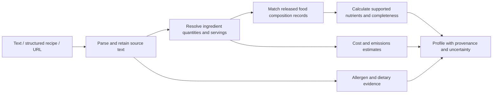

# Recipe analysis

Updated 30 October 2026. Delivery order and decisions live in [the working plan](PLAN.md). Evaluation methods live in [METHODS.md](../evaluation/METHODS.md).

## Current implementation

The API accepts recipe text, structured ingredients, or an extracted URL preview. Raw text passes through the recipe parser. Structured ingestion can bypass that parser; it still needs source-line alignment, quantity resolution, food matching, and profiling. Evaluate these entry paths separately.

| Responsibility | Implementation to inspect or extend |
|---|---|
| HTTP input, profile/create/read responses | `src/recipe_wrangler/api/routers/recipes.py` |
| Text recipe and ingredient parsing | `tools/parse_recipe_tool.py` |
| Structured splitting and workflow | `tools/recipe_profiling_chain.py` |
| Household measures, item/package weights | `tools/ingredient_weight_tool.py`, `tools/reviewed_item_weights.py` |
| Matching, release identity, quantities | `matching/`, `repositories/matching_store.py`; see [MATCHING.md](MATCHING.md) |
| Nutrition aggregation and completeness | `tools/nutritional_calculator.py`, `tools/nutrition_completeness.py` |
| Unified profile and quality metadata | `tools/recipe_profiling_tool.py` |
| Sustainability evidence and calculation | `tools/sustainability_calculator.py` |
| Monetary estimates | `pricing/`; see [COST.md](COST.md) |
| Allergen/consumer classification | `utils/food_ontology.py`, `repositories/neo4j_recipes.py`, `utils/diet_tags.py` |
| Saved profile and catalogue projection | `utils/nutrition_postgres.py`, `catalog/projection.py`, `matching/projection_worker.py` |

Paths abbreviated in the table are relative to `src/recipe_wrangler/`.

## Contracts to preserve and test

1. Retain original text, source URL/ID, parsed fields, ingredient occurrence position, measurement, display quantity, effective grams, and reasons for any correction. A shared ingredient name cannot carry recipe-specific quantities or modifiers for every occurrence.
2. A source's household quantity and the grams used for calculation are different fields. Display priority is original source text, stored parser display, supported culinary conversion, then calculation fallback. Do not change nutrition grams to make the displayed units prettier.
3. Preserve alternatives and compound structure. A shared quantity must not be applied in full to every `or` branch. Salt and pepper splitting, package multipliers, and source-line concatenation repairs need explicit cases.
4. Distinguish as-purchased, edible, drained, raw, cooked, reconstituted, and unknown quantity bases. Volume is not automatically mass. Cooking instructions describe intended transformations and do not establish the ingredient's initial state by themselves.
5. Record given versus inferred servings. Recalculate recipe totals and per-serving values consistently, including source-provided serving weight and cooked yield where available.
6. For supported matched food, ingredient nutrient contribution is `effective grams / 100 × nutrient per 100 g`. Do not combine incompatible nutrient definitions or apply retention losses twice.
7. Missing values remain unknown. Complete totals and supported partial sums are separate; match count and mass coverage do not prove nutrient completeness. A score needs all required inputs and a declared mass basis.
8. Preserve observed ingredient facts separately from selected-record facts and calculation assumptions. Neither a proxy composition nor an LLM explanation creates observed evidence.

## Structured weight fallback

The default weight path remains legacy; `portion_inputs` opts into structured
portion matching. With `WEIGHT_PORTION_TABLE_ONLY=true` (default), non-built-in
names absent from the reviewed portion table abstain from deterministic matching.
With the separate `LIVE_WEIGHT_LLM_ENABLED=true` opt-in, unresolved ranked requests
can use the existing LLM estimator. Supplied portion facets are included in its
input. Strict mode, invalid/non-positive quantities, contradictory facets and
invalid food IDs do not trigger it; existing successful portions and direct mass
conversions are retained.

Accepted estimates must be finite and pass the existing per-unit plausibility
checks. Their details identify the LLM source and retain the deterministic
`facet_matching` abstention, `pre_llm_error` and `pre_llm_match_type`; an LLM estimate
does not create a portion reference. Failed/rejected estimates remain unresolved.
The structured fallback does not write its estimates into the reference/cache
tables. Configure a hosted provider for evaluation; no local generative model is
an authorized fallback. Independent accuracy and complete pipeline evaluation are
still pending; see [weight evaluation](../evaluation/weight_calculation/README.md).

## Important audit targets

The current general profiling node calls `_sanitize_serves`, applies source-specific weight adjustments, and calls `_cap_recipe_weights` before invoking profiling. The legacy calculator also contains weight/concentrate safeguards. The 29 October matching reports describe uncapped calories and shared corrected masses for the saved release; that does not establish that every new-analysis entry path uses identical mass policies. Compare saved-recipe, text-analysis, structured-analysis, and import behavior on the same inputs before claiming parity. Review the effect of each heuristic on ordinary and large-batch recipes rather than removing safeguards blindly.

Reference importers also need checking: for example, `scripts/import_slovenian.py` currently has a float helper defaulting missing values to zero, while `scripts/prepare_essrg.py` treats source trace markers as zero and scales g/ml quantities directly. Determine which raw rows are affected and preserve missing/trace semantics in new reference adapters. Do not retroactively overwrite reference data to improve evaluation results.

Historical investigation identified suspect saturated-fat values in Slovenian olive-oil cultivar entries. The old handoff reported no selected live occurrences at that time. Treat the source values and present impact as unverified until the composition audit reruns; do not repair them by guessing a typical olive-oil value.

## Allergen and dietary evidence

The unsaved Analyze Recipe response derives allergen evidence from ingredient names. Saved recipes additionally use keyword/FoodOn enrichment and project evidence into the catalogue. These paths require their own evaluations: tests of the helper alone cannot establish that source text, graph declarations, and search results agree.

Include the EU allergen groups and the project's internal identifiers/crosswalks. Test peanut versus tree nuts; fish versus crustaceans versus molluscs; wheat versus gluten; compound sauces, dairy alternatives, plant substitutes, qualifiers, and negation. Keep `contains`, possible/inferred presence, and unknown assessment distinct. Absence of a detected keyword is not verified absence, and recipe text does not establish manufacturing cross-contact status. Use the [EU food information regulation](https://eur-lex.europa.eu/eli/reg/2011/1169/oj) as the authoritative category reference; legal exemptions and concentration-dependent cases require explicit evidence rather than blanket text rules.

Several keyword cases already have regression tests, including satay, Worcestershire, plant milks, gluten-free flours, eggplant, and butter beans. They are development checks, not a measured recall estimate. Broad suppression patterns such as `tamari` or lossy `gluten ...` names deserve adversarial tests against the original product wording.

The user-confirmed policy is to resolve unknown allergen assessments wherever
possible, and keep recipes with any remaining unresolved status visible with a
clear uncertainty flag and reason, including in allergy-filtered results. Known
allergen conflicts remain excluded. Preserve the flag in catalogue projections,
search cards and recipe details; an unresolved status must not become a confirmed
absence claim merely to achieve complete classification.

For vegan/vegetarian suitability, do not derive the full decision from allergen absence. Existing FATO-aligned suitability has three states. Inspect whether all entry paths and source tags honor that state, including contradictions and unclassified ingredients.

## Sustainability and time

Emissions matching has exact/alias/override/vector paths, class gates, and confidence metadata. Report source factor, kg CO2e/kg, weight basis, boundary where known, matched mass, and missing contributions. Some existing paths use zero contribution for an unmatched ingredient; evaluate and correct any presentation of that partial sum as a complete footprint. Catalogue estimates and hand overrides do not constitute measured recipe footprints.

Time is presently metadata and parsing/import behavior, rather than a supported enhancement objective. Separate preparation, cooking, waiting, and total elapsed time where the source supports them. A five-minute prep field must not become a five-minute total for a 90-minute curry. A later adaptation estimate must account for overlapping work and required safe cooking steps; summing every step duration is not a general elapsed-time calculation.

## Validation entry points

Reuse focused modules such as `test_allergen_detection.py`, `test_ingredient_line_splitter.py`, `test_ingredient_weight_confidence.py`, `test_original_ingredient_context.py`, `test_shared_recipe_quantities.py`, `test_nutrition_completeness.py`, `test_profiling_accuracy.py`, and `test_portion_display.py` under `tests/`. Execute appropriate tests when behavior changes. Passing unit tests and agreement between model runs are distinct from performance on reference-labelled examples.

## History

Dated implementation notes up to 12 November 2026 are kept locally in `analysis/docs-history-2026-11-12/`.
